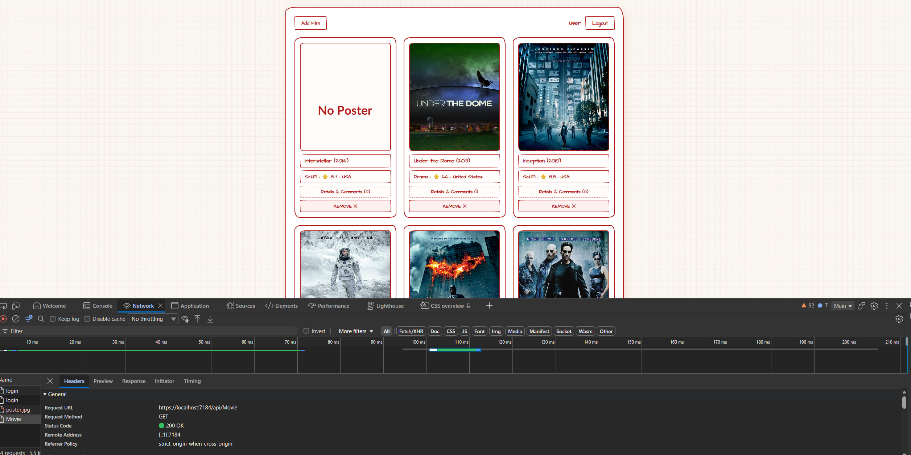

# Movie API & Frontend

## Запуск

### 1. Backend
1. Відкрити `less10.slnx` у Visual Studio (рядок підключення `"def"` у `less10/appsettings.json`).
2. У **Package Manager Console** (Default project: `Dll`) виконати:
   ```powershell
   Update-Database
   ```
3. Запустити `less10` (`F5`) — API стартує на `https://localhost:7184`.

### 2. Додавання 10 фільмів у БД
Виконати в **SQL Server Object Explorer** → **New Query**:
```sql
INSERT INTO Movies (Title, Description, ReleaseYear, Rating, Genre, PosterUrl, FilmUrl, Country)
VALUES
('Inception', 'A thief who steals corporate secrets through dream-sharing technology.', 2010, 8.8, 'Sci-Fi', '[https://m.media-amazon.com/images/M/MV5BMjAxMzY3NjcxNF5BMl5BanBnXkFtZTcwNTI5OTM0Mw@@._V1_.jpg](https://m.media-amazon.com/images/M/MV5BMjAxMzY3NjcxNF5BMl5BanBnXkFtZTcwNTI5OTM0Mw@@._V1_.jpg)', '[https://www.imdb.com/title/tt1375666/](https://www.imdb.com/title/tt1375666/)', 'USA'),
('Interstellar', 'A team of explorers travel through a wormhole in space in an attempt to ensure humanity survival.', 2014, 8.7, 'Sci-Fi', '[https://m.media-amazon.com/images/M/MV5BZjdkOTU3MDktN2IxOS00OGEyLWFmMjktY2FiMmZkNWIyODZiXkEyXkFqcGdeQXVyMTMxODk2OTU@._V1_.jpg](https://m.media-amazon.com/images/M/MV5BZjdkOTU3MDktN2IxOS00OGEyLWFmMjktY2FiMmZkNWIyODZiXkEyXkFqcGdeQXVyMTMxODk2OTU@._V1_.jpg)', '[https://www.imdb.com/title/tt0816692/](https://www.imdb.com/title/tt0816692/)', 'USA'),
('The Dark Knight', 'Batman raises the stakes in his war on crime against the Joker.', 2008, 9.0, 'Action', '[https://m.media-amazon.com/images/M/MV5BMTMxNTMwODM0NF5BMl5BanBnXkFtZTcwODAyMTk2Mw@@._V1_.jpg](https://m.media-amazon.com/images/M/MV5BMTMxNTMwODM0NF5BMl5BanBnXkFtZTcwODAyMTk2Mw@@._V1_.jpg)', '[https://www.imdb.com/title/tt0468569/](https://www.imdb.com/title/tt0468569/)', 'USA'),
('The Matrix', 'A computer hacker learns from mysterious rebels about the true nature of his reality.', 1999, 8.7, 'Sci-Fi', '[https://m.media-amazon.com/images/M/MV5BNzQzOTk3OTAtNDQ0Zi00ZTVkLWI0MTEtMDllZjNkYzNjNTc4L2ltYWdlXkEyXkFqcGdeQXVyNjU0OTQ0OTY@._V1_.jpg](https://m.media-amazon.com/images/M/MV5BNzQzOTk3OTAtNDQ0Zi00ZTVkLWI0MTEtMDllZjNkYzNjNTc4L2ltYWdlXkEyXkFqcGdeQXVyNjU0OTQ0OTY@._V1_.jpg)', '[https://www.imdb.com/title/tt0133093/](https://www.imdb.com/title/tt0133093/)', 'USA'),
('Dune: Part Two', 'Paul Atreides unites with Chani and the Fremen while seeking revenge against the conspirators.', 2024, 8.5, 'Sci-Fi', '[https://m.media-amazon.com/images/M/MV5BN2QyZGU4ZDctOWMzMy00NTc5LThlOGQtODhmNDI1NmY5YzAwXkEyXkFqcGdeQXVyMDM2NDM2MQ@@._V1_.jpg](https://m.media-amazon.com/images/M/MV5BN2QyZGU4ZDctOWMzMy00NTc5LThlOGQtODhmNDI1NmY5YzAwXkEyXkFqcGdeQXVyMDM2NDM2MQ@@._V1_.jpg)', '[https://www.imdb.com/title/tt15239678/](https://www.imdb.com/title/tt15239678/)', 'USA'),
('Oppenheimer', 'The story of American scientist J. Robert Oppenheimer and his role in the development of the atomic bomb.', 2023, 8.3, 'Biography', '[https://m.media-amazon.com/images/M/MV5BMDBmYTZjNjUtN2M1MS00MTQ2LTk2ODgtNzc2M2QyZGE5NTVjXkEyXkFqcGdeQXVyNzAwMjU2MTY@._V1_.jpg](https://m.media-amazon.com/images/M/MV5BMDBmYTZjNjUtN2M1MS00MTQ2LTk2ODgtNzc2M2QyZGE5NTVjXkEyXkFqcGdeQXVyNzAwMjU2MTY@._V1_.jpg)', '[https://www.imdb.com/title/tt15398776/](https://www.imdb.com/title/tt15398776/)', 'USA'),
('Parasite', 'Greed and class discrimination threaten the newly formed symbiotic relationship between two families.', 2019, 8.5, 'Thriller', '[https://m.media-amazon.com/images/M/MV5BYWZjMjk3ZTItODQ2ZC00NTY5LWE0ZDYtZTI3MjcwN2Q5NTVkXkEyXkFqcGdeQXVyODk4OTc3MTY@._V1_.jpg](https://m.media-amazon.com/images/M/MV5BYWZjMjk3ZTItODQ2ZC00NTY5LWE0ZDYtZTI3MjcwN2Q5NTVkXkEyXkFqcGdeQXVyODk4OTc3MTY@._V1_.jpg)', '[https://www.imdb.com/title/tt6751668/](https://www.imdb.com/title/tt6751668/)', 'South Korea'),
('Gladiator', 'A former Roman General sets out to exact vengeance against the corrupt emperor.', 2000, 8.5, 'Action', '[https://m.media-amazon.com/images/M/MV5BMDliMmNhNDEtODUyOS00MjNlLTgxODEtN2U3NzIxMGVkZTA1L2ltYWdlXkEyXkFqcGdeQXVyNjU0OTQ0OTY@._V1_.jpg](https://m.media-amazon.com/images/M/MV5BMDliMmNhNDEtODUyOS00MjNlLTgxODEtN2U3NzIxMGVkZTA1L2ltYWdlXkEyXkFqcGdeQXVyNjU0OTQ0OTY@._V1_.jpg)', '[https://www.imdb.com/title/tt0172495/](https://www.imdb.com/title/tt0172495/)', 'USA'),
('The Shawshank Redemption', 'Two imprisoned men bond over a number of years, finding solace and eventual redemption.', 1994, 9.3, 'Drama', '[https://m.media-amazon.com/images/M/MV5BNDE3ODcxYzMtY2YzZC00NmNlLWJiNDMtZDViZWM2MzIxZDYwXkEyXkFqcGdeQXVyNjAwNDUxODI@._V1_.jpg](https://m.media-amazon.com/images/M/MV5BNDE3ODcxYzMtY2YzZC00NmNlLWJiNDMtZDViZWM2MzIxZDYwXkEyXkFqcGdeQXVyNjAwNDUxODI@._V1_.jpg)', '[https://www.imdb.com/title/tt0111161/](https://www.imdb.com/title/tt0111161/)', 'USA'),
('Spider-Man: Across the Spider-Verse', 'Miles Morales catapults across the Multiverse, where he encounters a team of Spider-People.', 2023, 8.6, 'Animation', '[https://m.media-amazon.com/images/M/MV5BMzI0NmVkMjEtYmY4MS00ZDMxLTlkZmEtMzU4MDQxYTMzMjU2XkEyXkFqcGdeQXVyMzQ0MzA0NTM@._V1_.jpg](https://m.media-amazon.com/images/M/MV5BMzI0NmVkMjEtYmY4MS00ZDMxLTlkZmEtMzU4MDQxYTMzMjU2XkEyXkFqcGdeQXVyMzQ0MzA0NTM@._V1_.jpg)', '[https://www.imdb.com/title/tt9362722/](https://www.imdb.com/title/tt9362722/)', 'USA');
```

### 3. Frontend
```bash
npm install
npm run dev
```
*(Для реєстрації пароль має містити велику/малу літери, цифру та спецсимвол, напр. `Pass123!`).*

## Скріншот
